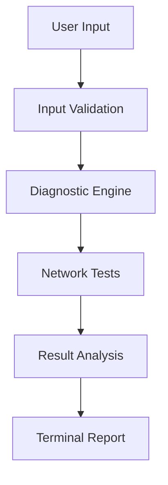
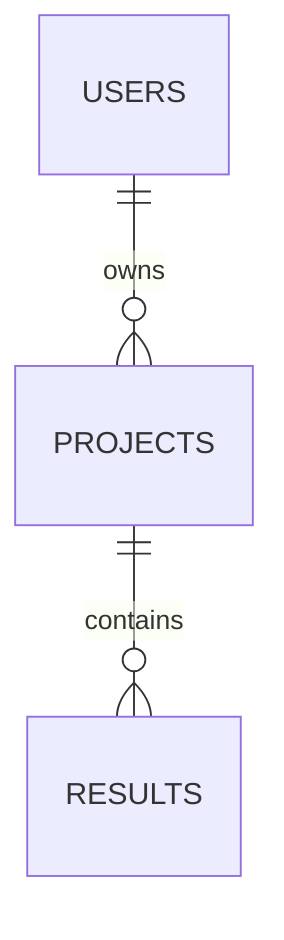

Act as a **Senior Software Engineer, Technical Writer, GitHub Repository Maintainer, and Software Documentation Architect**.

Create a complete, professional, human-written **README.md technical documentation** for the following GitHub project:

**Project Name:** [PROJECT NAME]

**Project Description:** [PROJECT DESCRIPTION]

**GitHub Repository:** [GITHUB REPOSITORY URL]

**Technology Stack:** [TECHNOLOGIES]

**Project Type:** [CLI / Web Application / REST API / Desktop Application / Automation / Security Tool / Networking Tool]

**Target Users:** [TARGET USERS]

**Project Level:** [BEGINNER / INTERMEDIATE / ADVANCED]

**Current Project Files/Structure:**
[PASTE PROJECT TREE HERE]

**Source Code:**
[PASTE CODE OR PROVIDE REPOSITORY/FILES]

---

# Documentation Objective

Generate a **human-readable, technically accurate README.md** that explains the project as if it were written by the developer who actually designed and built it.

The README must not sound like AI-generated marketing content.

Use clear, natural technical writing.

Do not use unnecessary buzzwords such as:

* Revolutionary
* Cutting-edge
* Next-generation
* Enterprise-grade
* Powerful
* Robust

unless they are technically justified.

Do not exaggerate project capabilities.

Do not invent features, benchmarks, technologies, APIs, security controls, test results, or implementation details that are not actually present in the project.

If information is missing, write:

`[TODO: Add information about ...]`

instead of inventing it.

---

# REQUIRED README STRUCTURE

Create the README using the following structure.

# 1. Project Title

Use:

```markdown
# [Project Name]
```

Immediately provide a concise description of what the project does.

Example:

```markdown
# Network Diagnostic CLI

A Python-based command-line tool that performs network connectivity,
DNS, gateway, and routing diagnostics to help identify common
network configuration problems.
```

---

# 2. Project Overview

Explain:

* What the project is
* What problem it solves
* Why it was built
* Who can use it
* What the application does at a high level

Keep this technical rather than promotional.

---

# 3. Real-World Problem

Explain the actual problem that motivated the project.

Use this format:

```markdown
## Real-World Problem

[Explain the problem.]

For example:

- What currently requires manual work?
- What information is difficult to obtain?
- What troubleshooting process is repetitive?
- What problem does this application simplify?
```

Clearly distinguish between the **problem** and the **solution**.

---

# 4. Solution

Explain how the project addresses the problem.

Describe:

```text
User
 ↓
Application
 ↓
Processing
 ↓
External service / system
 ↓
Result
 ↓
User
```

Use a simple Mermaid diagram when appropriate.

Example:



Do not create diagrams that do not accurately represent the source code.

---

# 5. Key Features

List the actual implemented features.

Example:

```markdown
## Key Features

- IPv4 and IPv6 validation
- DNS resolution testing
- Default gateway detection
- Internet connectivity testing
- Response-time measurement
- Human-readable CLI output
- JSON report generation
```

Do not list planned features as implemented features.

If a feature is planned, place it under:

```markdown
## Future Improvements
```

---

# 6. Technology Stack

Create a table:

| Technology | Purpose          |
| ---------- | ---------------- |
| Python     | Core application |
| FastAPI    | REST API         |
| PostgreSQL | Data storage     |
| pytest     | Testing          |
| Docker     | Containerization |

Only include technologies actually used.

---

# 7. Project Architecture

Explain the major components.

Example:

```text
User
 │
 ▼
CLI
 │
 ▼
Service Layer
 │
 ├── Network Diagnostics
 ├── DNS Resolver
 ├── Gateway Checker
 └── Report Generator
 │
 ▼
Output
```

Explain what each component does.

---

# 8. Project Directory Structure

Show the actual repository structure.

Example:

```text
project/
│
├── app/
│   ├── main.py
│   ├── config.py
│   ├── services/
│   │   ├── network.py
│   │   └── dns.py
│   └── utils/
│
├── tests/
├── requirements.txt
├── .env.example
├── .gitignore
└── README.md
```

Then explain each important file and directory.

Use a table where appropriate:

| File/Directory | Purpose                           |
| -------------- | --------------------------------- |
| `main.py`      | Application entry point           |
| `services/`    | Core application logic            |
| `tests/`       | Automated tests                   |
| `.env.example` | Example environment configuration |

Do not merely repeat the directory tree.

---

# 9. System Requirements

Specify:

* Operating system
* Python version
* Required software
* Database requirements
* External services
* Network requirements

Example:

```markdown
## Requirements

- Python 3.12+
- Git
- Internet connection
- Linux, Windows, or macOS
```

Only include requirements actually needed.

---

# 10. Installation

Provide exact commands.

Example:

```bash
git clone <repository-url>
cd <project-directory>

python -m venv .venv
```

Windows:

```powershell
.venv\Scripts\Activate.ps1
```

Linux/macOS:

```bash
source .venv/bin/activate
```

Then:

```bash
pip install -r requirements.txt
```

Explain every important command briefly.

Do not provide commands that have not been verified against the project structure.

---

# 11. Environment Configuration

If environment variables are used, document them.

Example:

```text
API_KEY=
DATABASE_URL=
SECRET_KEY=
```

Explain:

* Where the values come from
* Where they should be stored
* Why they are required

Explicitly state:

> Never commit `.env` files, passwords, API keys, tokens, or other secrets to Git.

---

# 12. How the Project Works

Provide a complete project workflow.

For example:

```text
1. User starts application
        ↓
2. Application reads input
        ↓
3. Input is validated
        ↓
4. Service layer performs operation
        ↓
5. External API/system is contacted
        ↓
6. Response is processed
        ↓
7. Data is normalized
        ↓
8. Result is displayed
```

Then explain each step.

This section must describe the **actual implementation flow**.

---

# 13. Step-by-Step Project Development

This is a critical section.

Document **how the project should be built from an empty directory**.

Do not simply describe the final project.

Show the recommended development order.

Example:

```text
Step 1 → Create project directory
Step 2 → Create virtual environment
Step 3 → Create main.py
Step 4 → Implement configuration
Step 5 → Implement input validation
Step 6 → Implement service layer
Step 7 → Implement API integration
Step 8 → Implement output formatting
Step 9 → Add error handling
Step 10 → Add tests
Step 11 → Add documentation
```

For every step provide:

### Step N — [Task]

Explain:

* What is being built
* Why it is being built at this stage
* Which file should be created/modified
* What code should be implemented
* What the code is responsible for
* How it connects to the previous step
* How to test it

---

# 14. File-by-File Build Order

Create a dedicated section showing the recommended implementation sequence.

Example:

```text
01. requirements.txt
02. .gitignore
03. .env.example
04. app/config.py
05. app/models.py
06. app/services/network.py
07. app/services/dns.py
08. app/utils/formatting.py
09. app/main.py
10. tests/test_network.py
11. tests/test_dns.py
12. README.md
```

Then explain why this order is logical.

For each file provide:

```markdown
### 1. `requirements.txt`

Purpose:
Defines the project's Python dependencies.

Implemented functionality:
[...]

Dependencies:
[...]

Depends on:
[...]

Used by:
[...]
```

Do this for all important source files.

---

# 15. Code Implementation Walkthrough

Explain the important program logic **in implementation order**.

Do not dump the entire source code unnecessarily.

Instead use focused examples.

For example:

### Step 1 — Define the data model

```python
class DiagnosticResult:
    ...
```

Explain:

* Why this class exists
* What each attribute represents
* Where it is used

### Step 2 — Implement validation

```python
def validate_ip(address):
    ...
```

Explain the logic.

### Step 3 — Implement service logic

```python
def run_diagnostics():
    ...
```

Explain how the components interact.

Continue until the major workflow is covered.

The objective is to allow another developer to **rebuild the project from the documentation**.

---

# 16. Complete Program Flow

Provide a concise execution flow.

Example:

```text
main()
 │
 ├── parse_arguments()
 │
 ├── validate_input()
 │
 ├── run_diagnostics()
 │      ├── check_interface()
 │      ├── check_gateway()
 │      ├── check_dns()
 │      └── check_internet()
 │
 └── display_results()
```

Explain the call relationship.

---

# 17. API Documentation

If the project contains APIs, document:

* Endpoint
* HTTP method
* URL
* Authentication
* Request parameters
* Request body
* Response
* HTTP status codes
* Error responses

Example:

```text
GET /api/diagnostic
```

Request:

```json
{
  "host": "example.com"
}
```

Response:

```json
{
  "status": "success",
  "latency_ms": 42
}
```

Only document endpoints that actually exist.

---

# 18. CLI Usage

If the project has a CLI, document all important commands.

Example:

```bash
python main.py --help
python main.py 8.8.8.8
python main.py --json 8.8.8.8
```

Show realistic example output.

Do not invent output that differs from the implementation.

---

# 19. Web Interface

If the project has a web interface, document:

* Available pages
* User workflow
* Forms
* API communication
* Important UI components

Include screenshots only if available.

Use placeholders if screenshots are missing:

```text
[TODO: Add dashboard screenshot]
```

---

# 20. Database Design

If a database is used, document:

* Tables
* Columns
* Relationships
* Primary keys
* Foreign keys
* Important indexes

Include an ER diagram using Mermaid when useful.

Example:



Only represent the actual schema.

---

# 21. Error Handling

Document how the application handles:

* Invalid input
* Network errors
* API failures
* Authentication failures
* Missing configuration
* Database errors
* Timeouts
* Unexpected responses

Explain what users see when an error occurs.

---

# 22. Security

Document security practices actually implemented.

Consider:

* Input validation
* Authentication
* Authorization
* Password hashing
* Secrets management
* HTTPS
* Rate limiting
* SQL injection prevention
* XSS protection
* CSRF protection
* Secure cookies
* File-upload validation
* Logging

Do not claim a security feature exists unless it is implemented.

For security-sensitive projects, explicitly document:

```text
Authorized Use Only
```

and explain the intended scope.

---

# 23. Testing

Document:

* Testing framework
* Test directory
* Unit tests
* Integration tests
* Mocking
* Important test scenarios

Provide commands such as:

```bash
pytest
```

If coverage is configured:

```bash
pytest --cov
```

Do not invent coverage percentages.

---

# 24. Example Usage

Provide realistic examples demonstrating the project.

Include:

```text
Input
 ↓
Command/API request
 ↓
Processing
 ↓
Output
```

Use screenshots or terminal output when available.

---

# 25. Troubleshooting

Create a troubleshooting section for common problems.

Format:

### Problem: [Problem]

**Cause:**
[Explanation]

**Solution:**

```bash
[command]
```

Only include realistic problems related to the project.

---

# 26. Limitations

This section is mandatory.

Explain what the application **cannot** do.

Examples:

* External API limitations
* Platform restrictions
* Accuracy limitations
* Operating-system limitations
* Permission requirements
* Rate limits
* Network dependencies

Do not hide limitations.

---

# 27. Future Improvements

Separate planned functionality from current functionality.

Example:

```markdown
- Add web dashboard
- Add Docker deployment
- Add scheduled monitoring
- Add additional API providers
- Add notification support
```

Do not describe these as currently implemented.

---

# 28. Learning Outcomes

Explain what technical skills a developer can learn by building this project.

For example:

* Python programming
* HTTP
* REST APIs
* Networking
* Linux
* SQL
* Authentication
* Error handling
* Testing
* Git
* Docker

Connect each learning outcome to an actual project component.

---

# 29. Resume Relevance

Explain the professional skills demonstrated by the project.

Provide **2–3 technically accurate resume bullet options** based only on implemented functionality.

Do not invent:

* Performance numbers
* User counts
* Cost savings
* Security improvements
* Production deployments

unless those facts are provided.

---

# 30. Git Workflow

Provide a simple professional Git workflow.

Example:

```bash
git init
git add .
git commit -m "Initial project setup"
git branch -M main
git remote add origin <repository-url>
git push -u origin main
```

For feature development:

```text
main
 │
 ├── feature/network-diagnostics
 ├── feature/report-generation
 └── feature/tests
```

Explain when commits should be made.

---

# 31. Project Development Timeline

Provide a realistic development sequence.

Example:

```text
Day 1 → Project setup
Day 2 → Core functionality
Day 3 → API integration
Day 4 → Error handling
Day 5 → Testing
Day 6 → Documentation
```

Do not underestimate complex work.

---

# 32. Contribution

Explain how another developer can:

1. Fork the repository
2. Create a branch
3. Make changes
4. Run tests
5. Commit changes
6. Create a pull request

---

# 33. License

If a license exists, document it.

If no license has been selected, use:

```text
[TODO: Choose and add a project license]
```

Do not invent a license.

---

# 34. Author

Use the actual author information supplied by the user.

Do not invent:

* Name
* Email
* Website
* Social media

---

# Writing Style Requirements

Write like a developer documenting a project for another developer.

Use:

* Short paragraphs
* Clear headings
* Tables where useful
* Code blocks
* Bullet points
* Mermaid diagrams where useful
* Technical terminology
* Concrete examples

Avoid:

* Marketing language
* Excessive emojis
* Artificial enthusiasm
* Repetitive explanations
* Huge walls of text
* Unnecessary theory
* Generic statements such as "This project showcases cutting-edge technology."

The documentation should be understandable by a developer who has never seen the project before.

---

# Accuracy Rules

Before producing the README:

1. Inspect the project structure.
2. Identify the actual entry point.
3. Identify actual dependencies.
4. Identify actual APIs.
5. Identify actual database models.
6. Identify actual commands.
7. Identify actual configuration.
8. Identify actual tests.
9. Identify security controls that are really implemented.
10. Identify limitations.

Do not assume functionality based only on filenames.

If the source code contradicts the requested description, **document the source code accurately** and mention the discrepancy.

---

# Final README Quality Check

Before returning the final README, verify:

* [ ] Project purpose is clear
* [ ] Real-world problem is explained
* [ ] Solution is explained
* [ ] Architecture is documented
* [ ] Workflow is documented
* [ ] Directory structure is documented
* [ ] File-by-file development order is documented
* [ ] Important code logic is explained
* [ ] Installation is reproducible
* [ ] Configuration is documented
* [ ] CLI/API usage is documented
* [ ] Error handling is documented
* [ ] Security is documented
* [ ] Testing is documented
* [ ] Limitations are documented
* [ ] Future improvements are separated from current features
* [ ] Git workflow is included
* [ ] No functionality has been invented
* [ ] No fake benchmarks have been added
* [ ] No fake screenshots or links have been added
* [ ] No secrets are included
* [ ] Writing sounds human and technical

## Final Output

Return **only the complete `README.md` content** in Markdown.

The README must be ready to copy directly into the GitHub repository.

Do not surround the entire README with another Markdown code block.

Do not provide a separate explanation outside the README.
